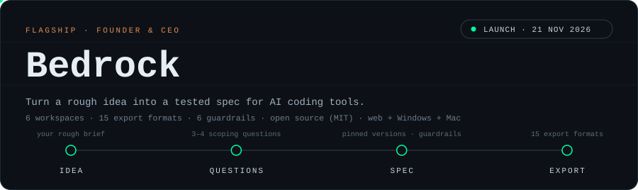
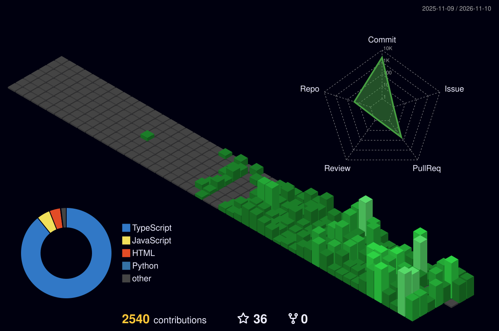

<div align="center">



[](https://atharva-portfolio-self.vercel.app/)
[](https://www.linkedin.com/in/atharva-kulkarni-a16a5a3b9/)
[](https://www.youtube.com/@AtharvaKulkarni-k5f)
[](https://bedrockxai.com)

</div>


## `> whoami`

```yaml
identity:
  name     : Atharva Kulkarni
  handle   : AtharvaK-XD
  location : Vadodara, Gujarat, India
  bio      : "Hunting vulnerabilities. Building interfaces. Doing both at once."

roles:
  - Founder & CEO             [ Bedrock · bedrockxai.com ]
  - Cybersecurity Enthusiast  [ TryHackMe · Burp Suite · Kali Linux ]
  - Frontend Developer        [ React · JavaScript · Vite · Tailwind ]
  - Freelancer                [ Internshala · Fiverr ]
  - Hackathon Builder         [ Open Collabs · Full-Stack Projects ]

currently:
  - Building Bedrock full-time as a solo founder — public launch 21 Nov 2026
  - Dual-mode portfolio live — Frontend Dev ↔ Ethical Hacker
  - Building LinkedIn presence around AI & Cybersecurity
  - Sharpening offensive skills on THM & real-world CTFs
  - Open to: freelance gigs · hackathon collabs · internships
```

> **Security isn't a feature. It's a foundation.**
>
> I build at the intersection of *how things work* and *how things break* —
> designing interfaces that are beautiful, functional, and hardened from the ground up.


## `> ./bedrock --founder`

<div align="center">
<a href="https://bedrockxai.com"></a>
</div>

<br/>

I'm the founder and CEO of **[Bedrock](https://bedrockxai.com)**, an open-source prompt-engineering workstation. AI coding tools only build what you describe, and most of us describe things badly. Bedrock interviews you first, then writes a spec your AI can actually follow: pinned versions, guardrails and a definition of done. Compare two models side by side, then export to `CLAUDE.md`, `.cursorrules`, `.windsurfrules` and 12 more formats. The desktop app is bring-your-own-key and works with Ollama.

**[Try it](https://bedrockxai.com)** · **[Source on GitHub](https://github.com/Bedrockxai/Bedrock)** · **[Org](https://github.com/Bedrockxai)**


## `> ls -la ./projects`

| Project | What it does | Stack | Live |
|---------|-------------|-------|------|
| **Bedrock** *(founder)* | Prompt-engineering workstation: guided questions → tested spec → 15 export formats, multi-model Arena, branching canvas, Windows + Mac app | `React · TypeScript · Vite · Tailwind · Electron · Neon · Clerk` | [bedrockxai.com](https://bedrockxai.com) |
| **Flick** | Study smarter, remember forever — AI-powered flashcard generation integrated with an active spaced repetition study engine | `React · Vite · Tailwind · Supabase · Gemini AI` | [flick-frontend-nine.vercel.app](https://flick-frontend-nine.vercel.app/) |
| **TheGitTimes** | Turns any GitHub profile into a vintage 1920s newspaper — sepia heatmap, magnifying loupe, AI-generated copy | `React · TypeScript · Vite · Tailwind · Gemini AI` | [the-git-times.vercel.app](https://the-git-times.vercel.app) |
| **Yapster** | Real-time online chatting app — clean, fast messaging built for casual conversation | `React · Vite · Tailwind · Supabase` | [yapster-chat.vercel.app](https://yapster-chat.vercel.app/) |
| **UrbanCart** | Multi-vendor e-commerce marketplace with Google OAuth & email auth | `React · Vite · Tailwind · Supabase` | [urban-cart-sage.vercel.app](https://urban-cart-sage.vercel.app/) |
| **RootLock** | Cyberpunk password strength analyzer with entropy scoring | `Vanilla JS` | [rootlock.netlify.app](https://rootlock.netlify.app/) |
| **BinRoute** | Smart waste management dashboard — live routes, fleet tracking & analytics | `React · Vite · Supabase` | [bin-route.vercel.app](https://bin-route.vercel.app/) |
| **Revvy** | AI code reviewer — bugs, security gaps, severity labels, 0–100 score | `React · TypeScript · FastAPI · Groq` | [revvy-iota.vercel.app](https://revvy-iota.vercel.app/) |
| **HyperFocus** | Cyberpunk deep-work tracker — logs distractions, scores focus sessions | `Vanilla JS` | [hyper-focus-y27c.vercel.app](https://hyper-focus-y27c.vercel.app/) |
| **GeoVault** | Sci-fi 3D globe marketplace — buy a country, yes really | `Three.js · WebGL` | [geovault.netlify.app](https://geovault.netlify.app/) |
| **KaliCMD** | 256 Kali Linux commands — search, browse, copy. Offline-first. | `HTML · CSS · JS` | [kalicmd.netlify.app](https://kalicmd.netlify.app/) |
| **CampusRent** | P2P rental marketplace for campus communities | `React · Node.js · Socket.io` | `soon` |
| **PickMySpot** | Real-time seat booking with Android APK | `HTML · CSS · JS` | `soon` |


## `> nmap --skills`

<div align="center">

**OFFENSIVE SECURITY**


**FRONTEND**


**BACKEND & TOOLS**


</div>


## `> git log --3d`

<div align="center">



</div>


## `> ./connect --now`

<div align="center">

**Got a project? I'm open to freelance, collabs, and hackathons.**

[](https://atharva-portfolio-self.vercel.app/)
[](https://www.linkedin.com/in/atharva-kulkarni-a16a5a3b9/)
[](https://bedrockxai.com)


</div>
